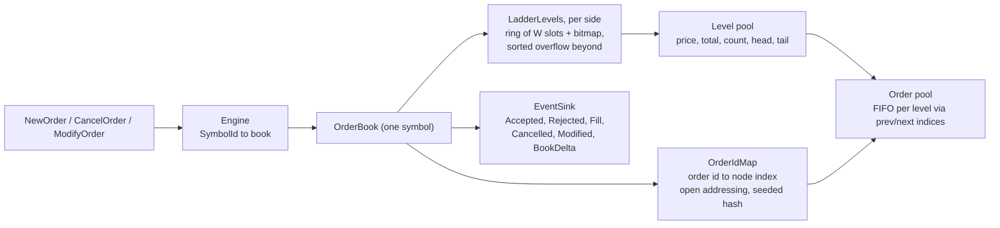

# orderbook-cpp

[](https://github.com/aozmekik/orderbook-cpp/actions/workflows/ci.yml)
[](LICENSE)

A limit order book and matching engine in C++20: price-time priority over
integer ticks, no exceptions on the hot path and no heap allocation within the
reserved capacity, and a deliberately simple reference engine that every
optimisation is tested against.

**Status: early (v0.1.0).** The API may change. It has not been used in
production; every number below comes from synthetic data on one laptop.

## Why

Most order book examples stop at "a `std::map` of `std::list`s". This one asks
how far a single-threaded book can be pushed with data structures shaped by
how order flow actually behaves (most activity a few ticks from the touch,
most orders cancelled), and how to keep such code honest: the optimised book
must emit exactly the same event stream as an obviously correct one, on
millions of random requests, with every invariant checked after every
request.

## Features

- **Orders:** limit (good till cancelled), market, IOC, FOK and post-only
  (rejected if it would cross; see [ADR 0003](docs/adr/0003-order-semantics.md)).
- **Cancel and modify** with exchange priority rules: a smaller size at the
  same price keeps time priority; a price change or a larger size loses it,
  and a new price that crosses matches like a new order.
- **Self-trade prevention:** `cancel_newest` or `cancel_oldest`, per book.
- **Events:** `Accepted`, `Rejected` (with a reason), `Fill` (taker and maker
  ids, taker side, price, quantity, both remainders), `Cancelled` (with a
  reason), `Modified` and level-2 `BookDelta`s; top-of-book and depth queries.
- **Many symbols:** `ob::Engine` routes requests to one book per symbol.
- **Integers only:** prices are `int64` ticks, quantities `int64` lots, as
  distinct strong types; no floating point anywhere in matching.
- **Deterministic:** the same requests always produce the same events, and
  `obreplay` prints byte-identical output for all three book implementations.
- **Tools:** `obreplay` replays a CSV order stream and prints trades and the
  final book; `obgen` generates synthetic, cancel-heavy, near-touch order
  flow.

## Quick start

Requirements: CMake 3.25+, Ninja and a C++20 compiler; the command-line tools
also need `<format>` (libstdc++ 13 or libc++ 17 and later). GoogleTest and
Google Benchmark are fetched by CMake at pinned versions. Everything below was
built and tested on macOS (Apple clang 21, Homebrew LLVM 23); the CI workflow
is set up for GCC 14 and Clang 18 on Ubuntu 24.04 and Apple Clang on macOS but
has not run yet (see Limitations).

```sh
git clone https://github.com/aozmekik/orderbook-cpp
cd orderbook-cpp
cmake --preset release
cmake --build --preset release
ctest --preset release

./build/release/apps/obreplay examples/orders.csv
```

```text
fill AAPL taker=6 maker=2 side=buy price=10055 qty=200 taker_left=150 maker_left=0
fill AAPL taker=6 maker=3 side=buy price=10055 qty=100 taker_left=50 maker_left=0
fill AAPL taker=7 maker=6 side=sell price=10055 qty=50 taker_left=550 maker_left=0
fill AAPL taker=7 maker=5 side=sell price=10050 qty=500 taker_left=50 maker_left=0
fill AAPL taker=7 maker=4 side=sell price=10045 qty=50 taker_left=0 maker_left=200
fill AAPL taker=8 maker=1 side=buy price=10060 qty=300 taker_left=100 maker_left=0
snapshot AAPL bids=1 asks=0
level AAPL bid price=10045 qty=200 orders=1
snapshot MSFT bids=1 asks=1
level MSFT ask price=41010 qty=50 orders=1
level MSFT bid price=41000 qty=50 orders=1
```

`--events` prints every event instead of only fills; `--stp=cancel_oldest`
turns on self-trade prevention; `--engine=map|reference` replays through the
other implementations. The input format is described in
[docs/csv-format.md](docs/csv-format.md).

```sh
./build/release/apps/obgen --commands=1000000 --seed=1 > build/orders.csv   # 30 MB, synthetic
./build/release/apps/obreplay --stats build/orders.csv > /dev/null
```

## Using the library

```cpp
#include <orderbook/orderbook.hpp>

ob::Engine engine(ob::BookConfig{.stp = ob::StpPolicy::cancel_newest});
const ob::SymbolId aapl = engine.add_symbol("AAPL");

// A sink is any callable that accepts every event type.
auto print = [&](const auto& event) {
  std::string line;
  ob::append_event(line, event, engine.symbol_names());
  std::cout << line;
};

using namespace ob;
engine.submit({aapl, OrderId{1}, OwnerId{10}, Side::sell, OrderType::limit, Price{10050}, Qty{100}}, print);
engine.submit({aapl, OrderId{2}, OwnerId{11}, Side::buy, OrderType::ioc, Price{10050}, Qty{40}}, print);
engine.modify({aapl, OrderId{1}, Price{10050}, Qty{50}}, print);  // keeps priority
engine.cancel({aapl, OrderId{1}}, print);

const ob::OrderBook& book = *engine.find_book(aapl);
std::optional<ob::LevelView> best = book.best_ask();
```

The full program is [examples/basic.cpp](examples/basic.cpp);
[examples/market_data.cpp](examples/market_data.cpp) rebuilds a level-2 book
from `BookDelta` events alone and checks it against the engine.

| Type | Role |
| --- | --- |
| `ob::OrderBook` | one symbol; `submit`, `cancel`, `modify`, `best_bid`, `best_ask`, `depth`, `find` |
| `ob::Engine` | one `OrderBook` per symbol, behind `add_symbol` and `apply(Command)` |
| `ob::BookConfig` | self-trade policy, order limit, reserved capacity, ladder window |
| `ob::Event` | `std::variant` of the six event types; `ob::VectorSink` collects them |
| `ob::MapOrderBook`, `ob::ReferenceBook` | the `std::map` baseline and the test oracle, same interface |
| `ob::CsvReader`, `ob::workload::generate` | order-stream I/O and synthetic flow |

Every request is answered synchronously through the sink; rejections are
events, never exceptions. The exact event order for each request is the
contract in [docs/semantics.md](docs/semantics.md). Sinks are passed by
lvalue reference, so that the events a sink collects cannot disappear with a
temporary; declare even an `ob::NullSink` before passing it.

## Install

Not yet published to vcpkg or Conan. With CMake's `FetchContent`:

```cmake
include(FetchContent)
FetchContent_Declare(
  orderbook
  GIT_REPOSITORY https://github.com/aozmekik/orderbook-cpp
  GIT_TAG v0.1.0
  GIT_SHALLOW TRUE)
FetchContent_MakeAvailable(orderbook)

target_link_libraries(my_app PRIVATE orderbook::orderbook)
```

As a subproject, only the library is built (tests, tools, benchmarks and
warnings-as-errors default to off). Or install it and use `find_package`:

```sh
cmake --preset release && cmake --build --preset release
cmake --install build/release --prefix "$HOME/.local"   # also installs obreplay and obgen
```

```cmake
find_package(orderbook 0.1 REQUIRED)
target_link_libraries(my_app PRIVATE orderbook::orderbook)
```

`tests/package/` is a downstream project that CI builds against the installed
package, as C++20 and as C++23, and through `FetchContent`.

Two settings matter to consumers:

- `OB_USE_STD_EXPECTED` (CMake option, default `OFF`): make `ob::expected`,
  the return type of the CSV parser, an alias of C++23 `std::expected`
  instead of the library's own fallback. The choice is fixed when the library
  is built and recorded in the generated `<orderbook/config.hpp>`, so code
  compiled as C++20 and as C++23 always agrees with the compiled library;
  turning it on makes C++23 a usage requirement.
- `OB_ENABLE_INVARIANT_CHECKS` (preprocessor macro, default `0`): define it to
  `1`, in every translation unit, to make each book re-check all of its
  invariants after every request and abort on a violation. It costs
  O(orders + levels) per request, so it is meant for tests; this project's
  own unoptimised builds turn it on.

## Design



- **Price levels in a ring around the touch.** Each side keeps the levels
  within a window of `W` ticks (4096 by default) in a ring indexed by
  `price mod W`, with an occupancy bitmap to find the next level in 64-tick
  steps; levels beyond the window live in a sorted vector. Near-touch
  inserts, lookups and removals are O(1). Bids are stored under negated prices, so one implementation
  serves both sides. [ADR 0001](docs/adr/0001-price-level-ladder.md)
- **The window follows the touch, with a brake.** A price better than the
  window moves it down at once; moving it back up waits until as many
  requests have passed as levels the last move touched, so an order that
  toggles far better than the best price costs amortised O(1) instead of a
  window move per request. [ADR 0001](docs/adr/0001-price-level-ladder.md) lists the
  cases that remain slow, with measurements.
- **Pools and intrusive queues.** Orders (40 bytes) and levels (32 bytes)
  live in contiguous pools addressed by 32-bit indices and recycled LIFO;
  each level is a doubly linked FIFO threaded through its orders, so a cancel
  from the middle of a queue is O(1). Order ids map to nodes through a
  linear-probing table with backward-shift deletion (no tombstones), hashed
  with a per-book random seed so that clients cannot choose ids that
  collide. [ADR 0002](docs/adr/0002-index-pools-and-intrusive-queues.md)
- **One matching core, two level structures.** `BasicOrderBook<Levels>` is
  parameterised on the level index, so the `std::map` baseline shares every
  other line with the optimised book and the benchmarks compare the level
  structure alone.
- **No exceptions on the hot path, no allocation within capacity.** Book
  operations are `noexcept`. An `OrderBook` that stays within
  `BookConfig::initial_capacity` (or `reserve()`) makes no heap allocation,
  wherever its price levels are: `tests/allocation_test.cpp` checks this with
  a counting global allocator on near-touch and wide synthetic streams, with
  levels outside the window and across window moves. Beyond it, pools grow
  geometrically, and running out of memory terminates.
- **Semantics where venues differ** (post-only rejects, modify sets the open
  quantity, FOK checks liquidity before touching the book, STP per book) are
  recorded in [ADR 0003](docs/adr/0003-order-semantics.md).

## Correctness

[ADR 0004](docs/adr/0004-differential-testing.md) explains the approach.

- **Differential tests:** 24 configurations (3 self-trade policies x ladder
  windows of 64 and 4096 ticks x 4 fixed seeds) replay adversarial random
  streams (all order types, duplicate, unknown and zero ids, invalid fields,
  prices at the ends of the valid range, jumps far past the ladder window)
  through the ladder book, the `std::map` book and the reference book, and
  require identical event vectors after every request: 2.4 million requests
  in debug builds and 6 million in release builds by default
  (`OB_DIFF_OPS=1000000` runs 24 million).
- **Invariants after every request** in this project's debug builds: the book
  is not crossed, every level's total and count equal the sum over its queue,
  links, pools, id map and ladder agree, and quantity is conserved.
- **Typed semantic tests** pin the event sequence of every rule for all three
  books; **golden files** pin `obreplay` output byte for byte for every
  engine.
- **Fuzzing:** `fuzz_csv` (parser round trips) and `fuzz_engine` (the three
  books against each other on arbitrary order streams, invariants checked
  after every command), with ASan, UBSan and assertions on.
- **Sanitizers:** the whole suite also runs under ASan + UBSan and TSan; the
  concurrency tests run engines on several threads at once.

Measured on 2026-10-18 at commit `f8aa1a6` on an Apple M1 Pro (16 GB, macOS
26.6.2):

| What | Result | Command and toolchain |
| --- | --- | --- |
| Test suite | 261 tests pass: 231 GoogleTest cases, 28 CLI tests, 2 example programs; 262 in release with the benchmark smoke test | `ctest --preset dev`, and the `release`, `cxx23`, `asan-ubsan` and `tsan` presets; Apple clang 21.0.0 |
| Long differential run | 24 configurations x 1,000,000 requests, identical events | `OB_DIFF_OPS=1000000 ./build/release/tests/orderbook_tests --gtest_filter='RandomStreams/*'` |
| Coverage of `include/` and `src/` | 96.6% of 2,156 lines, 99.6% of 272 functions, 92.8% of 981 branches | `scripts/coverage.sh /opt/homebrew/opt/llvm/bin`; Homebrew LLVM 23.1.3 (see note below) |
| `fuzz_csv` | 2,091,081 inputs in 61 s, no failure | `-max_total_time=60` on `fuzz/corpus/csv`; Homebrew clang 23.1.3, ASan + UBSan, assertions on |
| `fuzz_engine` | 1,882,937 inputs in 121 s, no failure | `-max_total_time=120` on `fuzz/corpus/engine`; same |
| Cross-toolchain determinism | identical SHA-256 of `obgen` output (1M commands, 30,730,531 bytes) and of `obreplay --events` on it, for all three engines | Apple clang 21 / libc++ vs. Homebrew GCC 14.2 / libstdc++ release builds |
| GCC 14 | library, tools and examples build with `-Werror`; tests and benchmarks pass `-fsyntax-only` with the same warnings | Homebrew GCC 14.2 against the macOS SDK (GoogleTest does not link there, so the tests were not run with GCC) |

Coverage note: an earlier run of the same command gave 92.7% of branches;
the cause of that 0.1-point spread was not found. `llvm-cov` also warns that
165 functions have mismatched profile data across the six instrumented
binaries; the figures are what it reports.

## Benchmarks

Google Benchmark, `release` preset (`-O3 -DNDEBUG`), Apple clang 21.0.0, Apple
M1 Pro, 16 GB, commit `f8aa1a6`. Run with
`./build/release/bench/orderbook_bench --benchmark_repetitions=10 --benchmark_report_aggregates_only=true`
on 2026-10-18 while other builds were running (1-minute load average 8.9 at
the start, 15.2 at the end, on 8 cores). Because of that load, the table
shows the median **CPU time** of 10 repetitions and its coefficient of
variation. Synthetic data throughout. Methodology, latency percentiles and
caveats: [docs/benchmarks.md](docs/benchmarks.md).

| Median CPU time per operation (CV) | Ladder | `std::map` | Reference | `std::map` / Ladder |
| --- | ---: | ---: | ---: | --- |
| Add a passive order (book grows to 65,536 orders) | 22.5 ns (5%) | 42.0 ns (5%) | 72.0 ns (3%) | 1.9x |
| Cancel a random resting order | 25.7 ns (3%) | 31.4 ns (20%) | 3,912 ns (8%) | no measurable difference |
| Market order of 100 to 500 lots (1 to 5 makers) | 70.6 ns (8%) | 93.8 ns (11%) | 146.5 ns (7%) | no measurable difference |
| `obgen` workload, per command | 24.9 ns (1%) | 33.9 ns (1%) | 120.9 ns (0.4%) | 1.4x |
| Wide workload (orders up to 20,000 ticks out), per command | 39.6 ns (0.2%) | 67.9 ns (2%) | 152.1 ns (3%) | 1.7x |
| Toggle one order 3,000 ticks better than the best of 3,000 ask levels | 64.0 ns (4%) | 42.7 ns (1%) | | 0.7x |
| Add or cancel among 100,000 levels outside the window | 15,581 ns (1%) | 152.2 ns (7%) | | 0.01x |

The ladder wins where price levels are created and removed: adds, and the
cancel-heavy synthetic streams. Cancels and fills of existing levels do not
reproduce a difference between runs. The last two rows are the ladder's known
worst cases, kept in the suite on purpose. Per-command latency on the `obgen`
stream is quantised by the 41.7 ns tick of `steady_clock` on Apple silicon;
Ladder and `std::map` tie at p50 (41 ns) and p99 (84 ns), and their p99.9
values (209 ns and 167 ns) are within the spread of the repetitions.

The default `obgen` stream (seed 1, 1,000,000 commands) is 55% new orders,
42% cancels and 3% modifies; 90.2% of the orders that leave the book are
cancelled rather than filled, and passive orders land 0 to 127 ticks behind
the touch with probability proportional to 1/(d+1). It is a simplified
zero-intelligence model, not a recording of a market.

## Limitations

- Single-threaded per book. Books share nothing, so symbols can be sharded
  across threads, but the engine itself does no threading or I/O.
- Self-trade prevention is a book-wide setting, not a per-order instruction.
- Post-only orders are rejected, never repriced.
- No stop orders, icebergs, time-in-force beyond IOC and FOK, auctions,
  trading halts or price bands.
- Levels outside the ladder window live in a sorted vector: adding or
  removing one moves O(n) entries (15.6 us with 100,000 such levels). An
  order more than W/8 ticks better than the best moves the window down; the
  move back up is delayed, so repeating that costs amortised O(1), but the
  request that moves the window pays O(levels moved), and toggling by about
  W or more moves it on every request (13.8 us with 3,000 levels). See
  [ADR 0001](docs/adr/0001-price-level-ladder.md).
- Growing a pool past its reserved capacity copies it (a latency spike
  proportional to the book size). Reserve for the worst case.
- The id-map seed stops clients from precomputing colliding order ids, but it
  is not a cryptographic key; `ReferenceBook`, the test oracle, is not
  hardened at all. A venue facing untrusted clients should still map their
  ids to its own.
- Events carry no timestamps or sequence numbers; CSV is the only wire format.
- Built and tested on macOS only. The CI workflow (Ubuntu 24.04 with GCC 14
  and Clang 18, macOS, sanitizers, fuzzing) is configured and passes
  `actionlint`, but has not run yet, because the repository has not been
  pushed. MSVC and Windows are not tested, and a shared-library build on
  Windows would need export annotations.

## Roadmap

- Per-order self-trade prevention, and an optional post-only "slide" mode.
- Sequence numbers on events and a binary input format (for example an
  ITCH-like feed) for replaying recorded data.
- A hierarchical occupancy bitmap so that the next level after a large gap is
  found in O(log64 W), and a better structure than a sorted vector for deep
  far-from-touch books (for example a B-tree over pooled nodes).
- Per-request-type latency histograms and a cycle-accurate timer where the
  platform offers one.
- Windows/MSVC support in CI.

## Contributing

Build, test, lint, fuzzing and coverage commands are in
[CONTRIBUTING.md](CONTRIBUTING.md). Changes are recorded in
[CHANGELOG.md](CHANGELOG.md).

## References

- J.-P. Bouchaud, M. Mezard and M. Potters, "Statistical properties of stock
  order books: empirical results and models", *Quantitative Finance* 2(4),
  2002: the power-law placement of limit orders around the touch.
- R. Cont, S. Stoikov and R. Talreja, "A stochastic model for order book
  dynamics", *Operations Research* 58(3), 2010: the zero-intelligence order
  flow that `obgen` simplifies.
- D. E. Knuth, *The Art of Computer Programming*, vol. 3, section 6.4,
  Algorithm R: deletion with linear probing without tombstones.
- A. Appleby, MurmurHash3, `fmix64` finalizer (public domain), and
  M. Dietzfelbinger, T. Hagerup, J. Katajainen and M. Penttonen, "A reliable
  randomized algorithm for the closest-pair problem", *Journal of
  Algorithms* 25(1), 1997 (multiply-shift hashing): the seeded order-id
  hash. G. Steele, D. Lea and C. Flood, "Fast splittable pseudorandom number
  generators", OOPSLA 2014: the SplitMix64 mixer that turns the seed into a
  multiplier.
- D. Blackman and S. Vigna, "Scrambled linear pseudorandom number
  generators", *ACM TOMS* 47(4), 2021: xoshiro256** for reproducible
  workloads; M. O'Neill, "Efficiently generating a number in a range", 2018.
- G. Tene, [HdrHistogram](https://github.com/HdrHistogram/HdrHistogram): the
  log-linear bucketing of the latency histogram.
- W. Selph, "How to build a fast limit order book", 2011: the classic
  description of the tree-of-levels plus intrusive-queue design that the
  `std::map` baseline follows.

## License

[MIT](LICENSE)

Built by [Ahmed Semih Özmekik](https://github.com/aozmekik) at [Fergani](https://fergani.tr).
