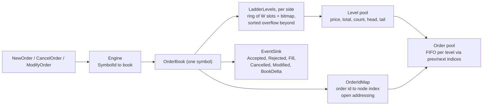

# orderbook-cpp

[](https://github.com/aozmekik/orderbook-cpp/actions/workflows/ci.yml)
[](LICENSE)

A limit order book and matching engine in C++20: price-time priority over
integer ticks, no heap allocation or exceptions on the hot path, and a
deliberately simple reference engine that every optimisation is tested
against.

**Status: early (v0.1.0).** The API may change. It has not been used in
production; every number below comes from synthetic data on one laptop.

## Why

Most order book examples stop at "a `std::map` of `std::list`s". This one asks
how far a single-threaded book can be pushed with data structures shaped by
how order flow actually behaves (most activity a few ticks from the touch,
most orders cancelled), and how to keep such code honest: the optimised book
must emit exactly the same event stream as an obviously correct one, on
millions of random requests, with every invariant checked after every
request.

## Features

- **Orders:** limit (good till cancelled), market, IOC, FOK and post-only
  (rejected if it would cross; see [ADR 0003](docs/adr/0003-order-semantics.md)).
- **Cancel and modify** with exchange priority rules: a smaller size at the
  same price keeps time priority; a price change or a larger size loses it,
  and a new price that crosses matches like a new order.
- **Self-trade prevention:** `cancel_newest` or `cancel_oldest`, per book.
- **Events:** `Accepted`, `Rejected` (with a reason), `Fill` (taker and maker
  ids, taker side, price, quantity, both remainders), `Cancelled` (with a
  reason), `Modified` and level-2 `BookDelta`s; top-of-book and depth queries.
- **Many symbols:** `ob::Engine` routes requests to one book per symbol.
- **Integers only:** prices are `int64` ticks, quantities `int64` lots, as
  distinct strong types; no floating point anywhere in matching.
- **Deterministic:** the same requests always produce the same events, and
  `obreplay` prints byte-identical output for all three book implementations.
- **Tools:** `obreplay` replays a CSV order stream and prints trades and the
  final book; `obgen` generates synthetic, cancel-heavy, near-touch order
  flow.

## Quick start

Requirements: CMake 3.25+, Ninja and a C++20 compiler (the CI workflow builds
with GCC 14 and Clang 18 on Ubuntu 24.04 and Apple Clang on macOS).
GoogleTest and Google Benchmark are fetched by CMake at pinned versions.

```sh
git clone https://github.com/aozmekik/orderbook-cpp
cd orderbook-cpp
cmake --preset release
cmake --build --preset release
ctest --preset release

./build/release/apps/obreplay examples/orders.csv
```

```text
fill AAPL taker=6 maker=2 side=buy price=10055 qty=200 taker_left=150 maker_left=0
fill AAPL taker=6 maker=3 side=buy price=10055 qty=100 taker_left=50 maker_left=0
fill AAPL taker=7 maker=6 side=sell price=10055 qty=50 taker_left=550 maker_left=0
fill AAPL taker=7 maker=5 side=sell price=10050 qty=500 taker_left=50 maker_left=0
fill AAPL taker=7 maker=4 side=sell price=10045 qty=50 taker_left=0 maker_left=200
fill AAPL taker=8 maker=1 side=buy price=10060 qty=300 taker_left=100 maker_left=0
snapshot AAPL bids=1 asks=0
level AAPL bid price=10045 qty=200 orders=1
snapshot MSFT bids=1 asks=1
level MSFT ask price=41010 qty=50 orders=1
level MSFT bid price=41000 qty=50 orders=1
```

`--events` prints every event instead of only fills; `--stp=cancel_oldest`
turns on self-trade prevention; `--engine=map|reference` replays through the
other implementations. The input format is described in
[docs/csv-format.md](docs/csv-format.md).

```sh
./build/release/apps/obgen --commands=1000000 --seed=1 > orders.csv
./build/release/apps/obreplay --stats orders.csv > /dev/null
```

## Using the library

```cpp
#include <orderbook/orderbook.hpp>

ob::Engine engine(ob::BookConfig{.stp = ob::StpPolicy::cancel_newest});
const ob::SymbolId aapl = engine.add_symbol("AAPL");

// A sink is any callable that accepts every event type.
auto print = [&](const auto& event) {
  std::string line;
  ob::append_event(line, event, engine.symbol_names());
  std::cout << line;
};

using namespace ob;
engine.submit({aapl, OrderId{1}, OwnerId{10}, Side::sell, OrderType::limit, Price{10050}, Qty{100}}, print);
engine.submit({aapl, OrderId{2}, OwnerId{11}, Side::buy, OrderType::ioc, Price{10050}, Qty{40}}, print);
engine.modify({aapl, OrderId{1}, Price{10050}, Qty{50}}, print);  // keeps priority
engine.cancel({aapl, OrderId{1}}, print);

const ob::OrderBook& book = *engine.find_book(aapl);
std::optional<ob::LevelView> best = book.best_ask();
```

The full program is [examples/basic.cpp](examples/basic.cpp);
[examples/market_data.cpp](examples/market_data.cpp) rebuilds a level-2 book
from `BookDelta` events alone and checks it against the engine.

| Type | Role |
| --- | --- |
| `ob::OrderBook` | one symbol; `submit`, `cancel`, `modify`, `best_bid`, `best_ask`, `depth`, `find` |
| `ob::Engine` | one `OrderBook` per symbol, behind `add_symbol` and `apply(Command)` |
| `ob::BookConfig` | self-trade policy, order limit, reserved capacity, ladder window |
| `ob::Event` | `std::variant` of the six event types; `ob::VectorSink` collects them |
| `ob::MapOrderBook`, `ob::ReferenceBook` | the `std::map` baseline and the test oracle, same interface |
| `ob::CsvReader`, `ob::workload::generate` | order-stream I/O and synthetic flow |

Every request is answered synchronously through the sink; rejections are
events, never exceptions. The exact event order for each request is the
contract in [docs/semantics.md](docs/semantics.md).

## Install

Not yet published to vcpkg or Conan. With CMake's `FetchContent`:

```cmake
include(FetchContent)
FetchContent_Declare(
  orderbook
  GIT_REPOSITORY https://github.com/aozmekik/orderbook-cpp
  GIT_TAG main)  # pin a commit SHA for reproducible builds
FetchContent_MakeAvailable(orderbook)

target_link_libraries(my_app PRIVATE orderbook::orderbook)
```

As a subproject, only the library is built (tests, tools, benchmarks and
warnings-as-errors default to off). Or install it and use `find_package`:

```sh
cmake --preset release && cmake --build --preset release
cmake --install build/release --prefix "$HOME/.local"   # also installs obreplay and obgen
```

```cmake
find_package(orderbook 0.1 REQUIRED)
target_link_libraries(my_app PRIVATE orderbook::orderbook)
```

`tests/package/` is a downstream project that CI builds against the
installed package.

## Design



- **Price levels in a ring around the touch.** Each side keeps the levels
  within a window of `W` ticks (4096 by default) in a ring indexed by
  `price mod W`, with an occupancy bitmap to find the next level in 64-tick
  steps; levels beyond the window live in a sorted vector. The window
  follows the touch with hysteresis. Near-touch inserts, lookups and removals
  are O(1). Bids are stored under negated prices, so one implementation
  serves both sides. [ADR 0001](docs/adr/0001-price-level-ladder.md)
- **Pools and intrusive queues.** Orders (40 bytes) and levels (32 bytes)
  live in contiguous pools addressed by 32-bit indices and recycled LIFO;
  each level is a doubly linked FIFO threaded through its orders, so a cancel
  from the middle of a queue is O(1). Order ids map to nodes through a
  linear-probing table with backward-shift deletion (no tombstones).
  [ADR 0002](docs/adr/0002-index-pools-and-intrusive-queues.md)
- **One matching core, two level structures.** `BasicOrderBook<Levels>` is
  parameterised on the level index, so the `std::map` baseline shares every
  other line with the optimised book and the benchmarks compare the level
  structure alone.
- **No exceptions or allocation on the hot path.** Book operations are
  `noexcept`. A book that stays within `BookConfig::initial_capacity` makes no
  heap allocation (checked by `tests/allocation_test.cpp` with a counting
  global allocator); beyond it, pools grow geometrically, and running out of
  memory terminates.
- **Semantics where venues differ** (post-only rejects, modify sets the open
  quantity, FOK checks liquidity before touching the book, STP per book) are
  recorded in [ADR 0003](docs/adr/0003-order-semantics.md).

## Correctness

[ADR 0004](docs/adr/0004-differential-testing.md) explains the approach.

- **Differential tests:** 24 configurations (3 self-trade policies x ladder
  windows of 64 and 4096 ticks x 4 fixed seeds) replay adversarial random
  streams (all order types, duplicate, unknown and zero ids, invalid fields,
  prices at the ends of the valid range, jumps far past the ladder window)
  through the ladder book, the `std::map` book and the reference book, and
  require identical event vectors after every request: 2.4 million requests
  in debug builds, 6 million in release builds.
- **Invariants after every request** in debug builds: the book is not
  crossed, every level's total and count equal the sum over its queue, links,
  pools, id map and ladder agree, and quantity is conserved.
- **Typed semantic tests** pin the event sequence of every rule for all three
  books; **golden files** pin `obreplay` output byte for byte for every
  engine.
- **Fuzzing:** `fuzz_csv` (parser round trips) and `fuzz_engine` (the three
  books against each other on arbitrary order streams), with ASan and UBSan.
- **Sanitizers:** the whole suite also runs under ASan + UBSan and TSan; the
  concurrency tests run engines on several threads at once.

Measured in this session on an Apple M1 Pro (16 GB, macOS 26.6.2):

| What | Result | Command and toolchain |
| --- | --- | --- |
| Test suite | 233 tests pass (215 GoogleTest cases, 18 CLI and example tests); 234 in release with the benchmark smoke test | `ctest --preset dev`, `ctest --preset release`, `asan-ubsan`, `tsan`, `cxx23`; Apple clang 21.0.0 |
| Coverage of `include/` and `src/` | 96.5% of lines, 92.3% of branches, 99.6% of functions | `scripts/coverage.sh /opt/homebrew/opt/llvm/bin`; Homebrew LLVM 23.1.3 |
| `fuzz_csv` | 1,828,250 inputs in 61 s, no failure | `-max_total_time=60`; Homebrew clang 23.1.3, ASan + UBSan |
| `fuzz_engine` | 1,993,991 inputs in 121 s, no failure | `-max_total_time=120`; same |
| Cross-toolchain determinism | identical SHA-256 of `obgen` output (1M commands) and of `obreplay --events` on it, all three engines | Apple clang 21 / libc++ vs. Homebrew GCC 14.2 / libstdc++ builds |

## Benchmarks

Google Benchmark, `release` preset (`-O3 -DNDEBUG`), Apple clang 21.0.0, Apple
M1 Pro, 16 GB. Run with
`./build/release/bench/orderbook_bench --benchmark_repetitions=5 --benchmark_report_aggregates_only=true`
while other builds were running (load average about 33 on 8 cores), so expect
noise; medians of 5 repetitions. Synthetic data throughout.
Methodology and caveats: [docs/benchmarks.md](docs/benchmarks.md).

| Median time per operation | Ladder | `std::map` | Reference |
| --- | ---: | ---: | ---: |
| Add a passive order (book grows to 65,536 orders) | 22.3 ns | 39.9 ns | 73.9 ns |
| Cancel a random resting order | 24.6 ns | 26.5 ns | 3,787 ns |
| Market order filling 1 to 5 makers | 75.1 ns | 76.8 ns | 137.6 ns |
| `obgen` workload, per command | 24.3 ns | 34.1 ns | 123.4 ns |
| Wide workload (orders up to 20,000 ticks out), per command | 39.5 ns | 69.4 ns | 151.3 ns |

| Per-command latency, `obgen` workload | p50 | p99 | p99.9 |
| --- | ---: | ---: | ---: |
| Ladder | 41 ns | 83 ns | 125 ns |
| `std::map` | 41 ns | 84 ns | 167 ns |
| Reference | 125 ns | 335 ns | 751 ns |

The ladder is 1.4x faster than the `std::map` baseline on the realistic
workload and 1.8x on adds; cancels and fills of existing levels cost about the
same, because they rarely create or remove a level. Latencies include two
clock reads and are quantised to the 41.7 ns tick of `steady_clock` on Apple
silicon, so the p50 only says "at most one tick".

The default `obgen` stream (seed 1, 1,000,000 commands) is 55% new orders,
42% cancels and 3% modifies; 90.2% of the orders that leave the book are
cancelled rather than filled, and passive orders land 0 to 127 ticks behind
the touch with probability proportional to 1/(d+1). It is a simplified
zero-intelligence model, not a recording of a market.

## Limitations

- Single-threaded per book. Books share nothing, so symbols can be sharded
  across threads, but the engine itself does no threading or I/O.
- Self-trade prevention is a book-wide setting, not a per-order instruction.
- Post-only orders are rejected, never repriced.
- No stop orders, icebergs, time-in-force beyond IOC and FOK, auctions,
  trading halts or price bands.
- Levels far from the touch live in a sorted vector: inserting or removing
  one costs O(n) in the number of such levels, and a stream that jumps the
  price by more than the window on every order moves the window every time.
- Growing a pool past its reserved capacity copies it (a latency spike
  proportional to the book size). Reserve for the worst case.
- Events carry no timestamps or sequence numbers; CSV is the only wire format.
- Tested on Linux and macOS only. MSVC and Windows are not tested, and a
  shared-library build on Windows would need export annotations.

## Roadmap

- Per-order self-trade prevention, and an optional post-only "slide" mode.
- Sequence numbers on events and a binary input format (for example an
  ITCH-like feed) for replaying recorded data.
- A hierarchical occupancy bitmap so that the next level after a large gap is
  found in O(log64 W), and a better structure than a sorted vector for deep
  far-from-touch books.
- Per-request-type latency histograms and a cycle-accurate timer where the
  platform offers one.
- Windows/MSVC support in CI.

## Contributing

Build, test, lint, fuzzing and coverage commands are in
[CONTRIBUTING.md](CONTRIBUTING.md). Changes are recorded in
[CHANGELOG.md](CHANGELOG.md).

## References

- J.-P. Bouchaud, M. Mezard and M. Potters, "Statistical properties of stock
  order books: empirical results and models", *Quantitative Finance* 2(4),
  2002: the power-law placement of limit orders around the touch.
- R. Cont, S. Stoikov and R. Talreja, "A stochastic model for order book
  dynamics", *Operations Research* 58(3), 2010: the zero-intelligence order
  flow that `obgen` simplifies.
- D. E. Knuth, *The Art of Computer Programming*, vol. 3, section 6.4,
  Algorithm R: deletion with linear probing without tombstones.
- A. Appleby, MurmurHash3, `fmix64` finalizer (public domain): the order-id
  hash.
- D. Blackman and S. Vigna, "Scrambled linear pseudorandom number
  generators", *ACM TOMS* 47(4), 2021: xoshiro256** for reproducible
  workloads; M. O'Neill, "Efficiently generating a number in a range", 2018.
- G. Tene, [HdrHistogram](https://github.com/HdrHistogram/HdrHistogram): the
  log-linear bucketing of the latency histogram.
- W. Selph, "How to build a fast limit order book", 2011: the classic
  description of the tree-of-levels plus intrusive-queue design that the
  `std::map` baseline follows.

## License

[MIT](LICENSE)

Built by [Ahmed Semih Özmekik](https://github.com/aozmekik) at [Fergani](https://fergani.tr).
